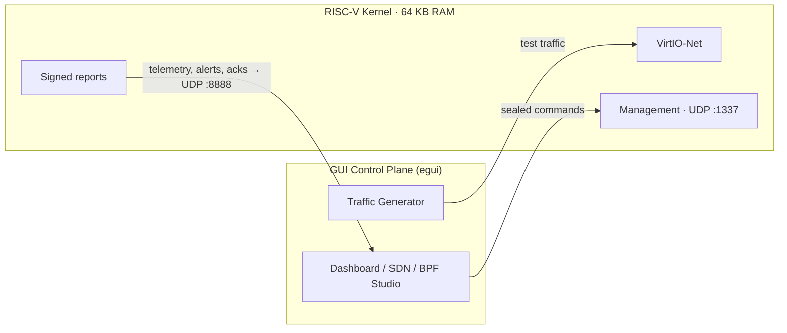
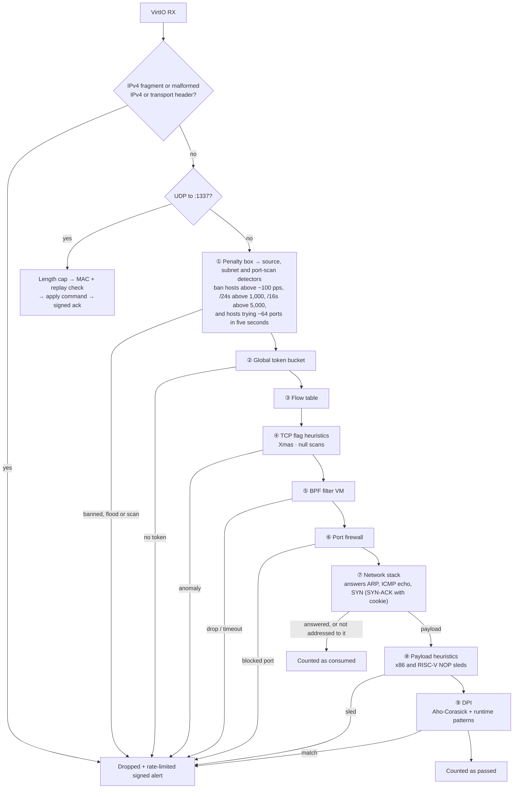
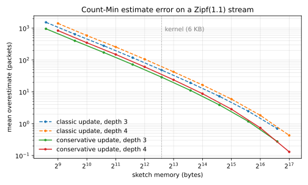
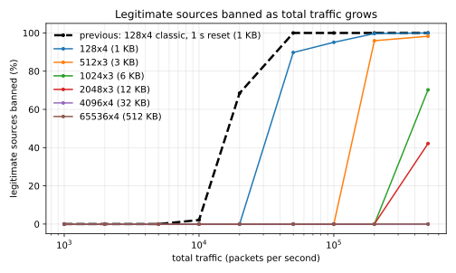
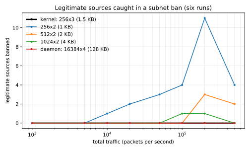
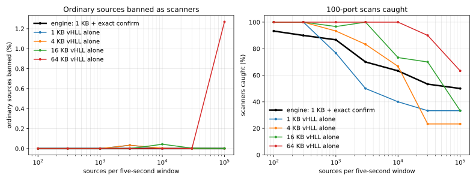
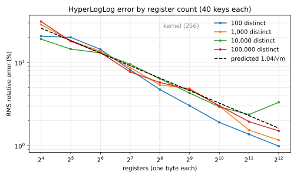
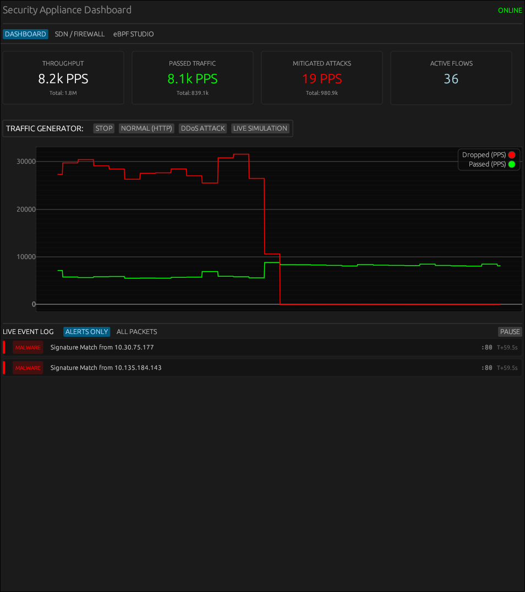

# RISC-V Security Unikernel

A bare-metal **network security appliance** written in Rust, running in M-mode on RISC-V without a host OS. Per-source and per-subnet flood detection, spoofed-flood and port-scan detection, rate limiting, a port firewall, deep packet inspection, heuristics and a programmable packet-filter VM all fit in a **64 KB RAM** budget.

The kernel inspects traffic addressed to it and reports verdicts; it does not forward packets. It is a demonstration of the techniques, not an inline firewall.



---

## The 64 KB Budget

| Structure | Size | Technique |
|---|---|---|
| Count-Min Sketch (sources) | 6 KB | 3 × 1024 × u16, SipHash-keyed, conservative update, halved every 0.5 s |
| Count-Min Sketch (subnets) | 1.5 KB | 3 × 256 × u16, one counter per /24 and per /16, same decay |
| Port-scan detector | 1.9 KB | 1 KB virtual HyperLogLog shared by every source, plus 8 suspects × 40 exact ports |
| HyperLogLog (distinct sources) | 256 B | 256 one-byte registers, cleared every 0.5 s |
| Flow table (74 entries) | ~3 KB | 5-tuple entries, LRU eviction with a minimum age |
| Aho-Corasick automaton | ~1.3 KB | 128-node trie for built-in signatures |
| VirtIO queues and buffers | ~6.3 KB | 2 RX + 2 TX MTU-sized buffers, rings on 64-byte legacy pages |
| BPF program slot | 520 B | 64 decoded instructions of 8 bytes (uploaded as 7 bytes each) |
| Penalty box | 384 B | 16 address or subnet bans; once every slot is active, detector bans are evicted round-robin and operator bans never are |
| **Hot-path allocations** | **0 B** | No heap; all state is static |

`make check-size` adds a 4 KB stack reserve to `.text + .rodata + .data + .bss` and fails if the total exceeds 64 KB. At commit b9dffce the kernel uses 62,204 of 65,536 bytes, about **60.7 KB**.

---

## Packet Processing Pipeline

Every received frame goes through `sec_core::engine::Engine::process`, which is plain Rust with no I/O and runs, is tested and is fuzzed on the host.



Management traffic is handled before any data-plane check, and every packet's MAC is verified (packets longer than the largest command are discarded unhashed), so no ban, filter program or flood can lock the operator out; only failed packets are rate-limited, to bound their alerts.

Every half second the main loop ends a detection interval: the sketches are halved, the distinct-source count is checked and cleared, and every tenth interval starts a new port-scan window. Detector alerts (subnet floods, source surges, port scans) bypass the alert rate limit.

---

## Security Mechanisms

### Count-Min Sketch — heavy-hitter detection
Counts packets per source IP in a Count-Min Sketch keyed with a per-boot SipHash key, using conservative update. Counters are halved every half second, so a source's estimate tracks its recent packet rate; one above 100 per second is banned in the penalty box.

### Subnet floods
Sources that pass their own check are also counted per /24 and per /16 in a second, smaller Count-Min Sketch with the same decay, so many moderate hosts in one network add up. A /24 above 1,000 pps or a /16 above 5,000 pps is banned as a prefix and reported with its rate. A loud host is banned alone before it counts toward its subnet, so it does not take its neighbours with it, and subnets containing the appliance's own address are never banned.

### Spoofed-source floods
A HyperLogLog counts distinct source addresses each half second. A moving average of past intervals, which leaves surges out, is the baseline; an interval with more than four times the baseline and over 1,000 sources raises one alert with the estimate. Spoofed addresses are not worth banning, so nothing is banned.

### Port scans
TCP connection attempts (SYN without ACK) feed a virtual HyperLogLog: each source's distinct destination ports are estimated from 32 registers scattered through one 1 KB pool that every source shares (Xiao et al., SIGMETRICS 2015). Sharing makes the estimates noisy once thousands of sources are active, so passing about 24 ports only makes a source a suspect. Up to eight suspects then record the ports they try exactly; 40 distinct ports, counting the one that made it a suspect (about 64 in all), within a five-second window get the source banned and reported. Replies never count, so a server answering many client ports is not mistaken for a scanner.

### Measuring the sketches

`make sketch-study` measures the sketches and detectors against exact ground truth (`crates/sketch-lab`) and redraws these charts.



On a skewed (Zipf 1.1) stream of 200k packets over 50k sources, conservative update cuts the average overestimate by 37–70% compared with the textbook update, depending on size; at the kernel's 6 KB it falls from 48 packets to 29.



The detector test runs legitimate sources at 5–20 pps alongside ten attackers at 300 pps for ten seconds, at increasing total traffic. The previous design (128 × 4, textbook update, reset every second) banned 68% of legitimate sources at 20k pps and all of them by 50k. At the same 1 KB, conservative update and decay hold out to 20k; the kernel's 6 KB sketch flags no legitimate source up to 200k pps, and the daemon's 512 KB one none at 500k. No configuration missed an attacker, and detection took 27–340 ms.

The study also caught a flaw in an earlier version of the hashing. Deriving each row's column as `h1 + i·h2` from one hash makes two sources that share `h1` and `h2` modulo the width collide in every row at once, so a legitimate source paired with an attacker this way was banned however many rows the sketch had. Each row now takes its column from its own slice of the 64-bit SipHash.



The subnet test scatters legitimate clients across the address space and adds a /24 of 20 hosts at 80 pps and a /16 of 100 hosts at 60 pps, none of them over the per-host limit, for six ten-second runs per load. A legitimate subnet that shares every row's counter with an attacking one is banned with it, so rows matter more than width: two rows of 256 (1 KB) banned up to 11 legitimate sources per load level and 1,024 × 2 (4 KB) still banned some, while the kernel's three rows of 256 (1.5 KB) and the daemon's 128 KB banned none. Up to 200k pps every configuration caught the /24 in about 0.9 s and the /16 in about 1.5 s; at 500k the kernel's per-source sketch saturates first.



The port-scan test fills five-second windows with ordinary sources opening connections to one to four service ports, and mixes in ten scanners trying 100 random ports and ten trying 300, over three seeds. A virtual HyperLogLog that bans on its own estimate bans ordinary sources once thousands share it (1.3% of them with 64 KB at 100k sources) and misses more scans as it fills. The engine's detector banned no ordinary source at any load. It caught every 300-port scan, and 100-port scans 93% of the time with 100 sources per window, falling to 50% with 100k.



Measured error follows the predicted 1.04/√m; the kernel's 256 registers count distinct sources to within about 6%. The rise at 4,096 registers and 10k items is HyperLogLog's known bias just above its switch from linear counting at 2.5 × the register count.

### Aho-Corasick DPI
Single-pass scan for the built-in signatures `DROP TABLE`, `<script>`, `eval(` and `UNION SELECT`. Up to eight more patterns of up to 32 bytes can be added and removed at runtime. Matching is case-sensitive and per packet.

### BPF filter VM
A small 16-register bytecode VM (not Linux eBPF) with load, move, compare, bitwise, jump and return instructions. Loads can be indexed by a register, and `Ldmsh` reads an IPv4 header's length as classic BPF's `ldxb 4*([k]&0xf)` does, so a program can reach the transport header behind IP options. Programs are validated on upload (opcodes, registers, jump targets, and a final `Ret` or `Jmp` so a program cannot run off its end), and run with a 1,000-instruction budget per packet. A `Ret` may only return 0 (drop) or 1 (pass); any other value is refused at upload. An empty upload removes the filter. The GUI's BPF Studio compiles `BLOCK <TCP|UDP> DST <port>` and `DROP ALL`.

### Heuristics
TCP Xmas (FIN|URG|PSH) and null scans; x86 NOP sleds (a decaying score that reaches 8, so interleaved junk bytes do not hide them) and runs of 8 RISC-V NOPs.

---

## Management Protocol

Commands are UDP datagrams to port 1337 carrying `counter (u64) ‖ reply MAC (6 bytes) ‖ reply IPv4 (4 bytes) ‖ body ‖ SipHash-2-4 MAC (u64)`. The counter's high 32 bits are the kernel's per-boot epoch and the low 32 bits a strictly increasing sequence, so commands cannot be forged or replayed within or across boots. The reply address is where the kernel sends its reports from then on; it is signed rather than taken from the frame's headers, so a captured command re-sent from another host cannot redirect them. The dashboard signs its own address on the interface that routes to the kernel. The kernel's key is set at build time (`KERNEL_MGMT_KEY`, or `.mgmt-key.local` created by `make dev-key`). The dashboard, the daemon and the QEMU harness read it at run time: `KERNEL_MGMT_KEY` if set, otherwise the nearest `.mgmt-key.local` in or above the working directory (the harness looks from its own crate directory). `sudo` drops the environment variable, so `sudo security-daemon run` finds the key only through that file.

| Command | Undo |
|---|---|
| `BlockPort` | `UnblockPort` |
| `AddDpiPattern` | `RemoveDpiPattern` |
| `UploadBpfProgram` | `UnloadBpfProgram` |
| `BanIp` | `UnbanIp` (also lifts any subnet ban covering the address) |

Every authenticated command is answered with an ack carrying its sequence number and outcome (applied, table full, invalid or refused).

The firewall blocks port 23 at boot and holds at most 16 ports; `BlockPort` for the management port 1337 is refused, since it would lock the operator out. Bans, the operator's `BanIp` included, expire after `IP_BAN_DURATION` (10 s at 1 GHz).

### Reports

Telemetry (every second), alerts and acks go to UDP port 8888, broadcast until an operator has authenticated and unicast afterwards to the reply address signed into the last accepted command. Each is signed with a key derived from the management key, so it cannot be forged or replayed back to the kernel as a command:

`epoch (u32) ‖ sequence (u64) ‖ body ‖ SipHash-2-4 MAC (u64)`

The telemetry body is a type byte followed by eleven big-endian u64 counters: passed, DDoS drops, firewall blocks, malware matches, BPF drops, heuristic drops, RAM used, active flows, management packets, the boot epoch and the last command sequence accepted this boot. The dashboard numbers its commands from that last one, so restarting it during a boot never reuses a sequence the kernel would reject.

---

## Dashboard



The companion desktop app (`egui`/`eframe`) shows live counters and the alert log, manages firewall rules, DPI patterns, address bans and BPF programs (with the kernel's ack for each), and generates test traffic. It accepts only reports that verify. Its LIVE NETWORK tab shows what the [network monitor](#network-monitor) sees.

**Traffic modes:** Normal (about 2 packets per millisecond), DDoS (300 per millisecond to common ports), Live (normal traffic with periodic attack payloads and DDoS bursts). Run `make setup_net_many` first so the generator sends from 200 real source addresses; otherwise it falls back to 50 sockets on the host and normal traffic trips the heavy-hitter detector.

---

## Technical Specifications

| Property | Value |
|---|---|
| Target ISA | RV64GC (`riscv64gc-unknown-none-elf`) |
| RAM budget | 64 KB |
| Language | Rust `no_std` / `no_main` |
| Network driver | VirtIO-Net (legacy MMIO), polled |
| Concurrency model | Single hart, polling loop; other harts are parked |
| Memory protection | PMP: W^X over the kernel image, MMIO confined to the device window, every other address denied |
| Build profile | `opt-level = "z"`, LTO, `codegen-units = 1`, stripped |

Thresholds and intervals are in `mcycle` cycles, so their wall-clock meaning depends on the CPU's clock rate. The durations in this README assume 1 GHz. Under QEMU without `-icount`, `mcycle` follows the host's time-stamp counter: on the i7-14700K the kernel's one-second telemetry tick came every 0.29 s, a rate of 3.4 GHz, so every interval and ban runs about 3.4 times faster than stated.

Beyond PMP, the kernel:

- seeds its per-boot secrets (sketch key, SYN-cookie secret, management epoch) from virtio-rng and, when built with `--features zkr`, the Zkr `seed` CSR, mixing in `mcycle` last; with neither strong source it prints a warning at boot;
- fills a 256-byte guard between `.bss` and the stack with a sentinel and halts if any byte has changed, checked every telemetry tick;
- installs a trap handler before any Rust code runs that prints `mcause`, `mepc` and `mtval` and halts, as the panic handler does.

---

## Benchmarks

The pure-logic modules are benchmarked on the host with [Criterion](https://github.com/bheisler/criterion.rs):

```bash
make bench
```

Medians on an Intel Core i7-14700K, measured at commit 6a9f5d1. The VM, flow table, DPI and heuristics have changed since, so these figures predate the current code:

| Benchmark | Median |
|---|---|
| `cms_insert` (single IP) | 7.5 ns |
| `cms_insert_64_ips` (varied) | 9.2 ns |
| `ac_scan_clean_payload` (102 B, no match) | 154 ns |
| `ac_scan_matching_payload` (early match) | 94 ns |
| `vm_execute_6_instructions` | 4.4 ns |
| `flow_update_new_flow` | 130 ns |
| `flow_update_existing_flow` | 2.3 ns |
| `flow_update_full_table_74_flows` | 42 ns |
| `heuristic_check_tcp_flags` | 0.7 ns |
| `heuristic_check_payload_clean` | 70 ns |
| `heuristic_check_payload_nop_sled` | 2.4 ns |
| `full_hot_path_per_packet` (CMS + Aho-Corasick + VM) | 168 ns |

---

## Linux Daemon

`security-daemon` runs the same `sec_core` engine as a Linux program, so the pipeline can be measured on real hardware and real traffic. It also carries a separate [network monitor](#network-monitor).

```bash
make daemon-bench DAEMON_ARGS="--threads 8 --mix clean"   # in-memory throughput
make daemon-speedtest                                      # live AF_PACKET test over a veth pair, no sudo
sudo ./target/release/security-daemon run --iface eth0     # inspect a real interface (needs CAP_NET_RAW)
```

`run` captures through a memory-mapped `TPACKET_V3` ring and sends replies and signed reports back out of the interface, so the GUI can drive it like the kernel. It takes on the kernel's identity from `sec_core::config` (192.168.100.2, `52:54:00:12:34:56`). `flood` sends synthetic clean, attack or mixed traffic out of an interface; `daemon-speedtest` points it at `run`. `bench` tells the engine traffic arrives at `--offered-pps` (default 10k) while measuring the real CPU cost per frame.

Measured at commit 6a9f5d1, before later changes to the engine's parsing, flow table and VM, on an Intel Core i7-14700K one engine handled about **1.3 Mpps** of clean traffic with every frame running the full pipeline (about 790 ns per frame, mostly the Aho-Corasick scan), and attack traffic from banned sources, dropped at the penalty box, at about 25 Mpps. Engines are independent, so throughput scaled with threads (about 11.5 Mpps on 16).

The daemon's engine uses a 65536 × 4 heavy-hitter sketch (512 KB) and a 16384 × 4 subnet sketch (128 KB) instead of the kernel's 6 KB and 1.5 KB ones, so its detectors stay accurate far past the kernel's 200k pps (see [Measuring the sketches](#measuring-the-sketches)); its port-scan detector is the kernel's. Above 100k pps the separate global rate limit, not the sketch, drops traffic.

### Network monitor

`security-daemon monitor` watches a real network, receive-only, and does not use the engine. It captures from one or more live interfaces (`--iface`, repeatable) or replays a classic pcap file (`--pcap`), decodes Ethernet with VLAN tags, IPv4 and IPv6, and tracks conversations and per-host traffic, telling local hosts from remote ones. It names hosts from what their traffic reveals: DNS and mDNS answers, and the server name in TLS ClientHellos, including those inside QUIC Initial packets, whose keys derive from the packet header. A name from an Encrypted Client Hello is marked as a cover name. Every second it prints traffic rates and the busiest remote hosts.

```bash
./target/release/security-daemon monitor --pcap capture.pcap         # replay a capture
./target/release/security-daemon monitor --iface eth0 --serve        # live (needs CAP_NET_RAW), streaming to viewers
make gui-live                                                         # the dashboard's live view on its own
```

Options can also come from a TOML file (`--config`; see `crates/daemon/monitor.example.toml`), and `--help` lists the rest. With `--serve`, each second's summary goes out as a line of JSON (`crates/monitor-proto`) on a Unix socket only the monitor's user can open; the dashboard's LIVE NETWORK tab and `security-dashboard --live` read it.

Capture needs `CAP_NET_RAW` only to open its sockets. The monitor then gives up root for the invoking user if started with `sudo`, clears every capability, and confines itself with Landlock (no filesystem access) and a seccomp filter, so a parser bug fed by hostile traffic cannot open files, start programs, make sockets, write to the capture socket or create executable memory. `security-daemon sandbox-check` applies the sandbox and reports each of these being refused.

---

## Testing

```bash
cargo test --workspace --exclude security-unikernel   # host unit, property and engine tests
make qemu-test                                         # boots the real kernel in QEMU
make miri                                              # sec-core tests under Miri
make fuzz-engine-sequence ARGS="-- -max_total_time=600"
make sketch-study                                      # sketch accuracy against ground truth
```

`make qemu-test` exchanges raw Ethernet frames with the kernel over a Unix socket (QEMU's `dgram` netdev), so it needs no tap device or root. Fuzz targets cover the packet stack, the whole engine (single frames and long sequences of frames, sealed commands and clock steps), the management verifier, the VM and the DPI automaton.

---

## Running

**Requirements:** Rust (pinned in `rust-toolchain.toml`; nightly for fuzzing and Miri) · `qemu-system-riscv64` · `iproute2` · `make`

On Nix, `nix develop` provides all of these.

```bash
# Build the kernel, configure the tap interface and launch QEMU
make run

# Launch the GUI (separate terminal)
make gui
```

1. On the **Dashboard** tab, click **NORMAL (HTTP)**, **DDoS ATTACK** or **LIVE SIMULATION**
2. Watch the counters, graph and event log for throughput and drop reasons
3. Use the **SDN / FIREWALL** tab to add or remove firewall rules and DPI signatures, and to ban or unban an address
4. Use the **BPF STUDIO** tab to upload or unload a packet filter

Press `Ctrl+B X` to exit QEMU.

---

## Limitations and Next Steps

This is a demonstration of the techniques, not a production security appliance:

- **Nothing is protected inline.** The kernel and `security-daemon run` answer and inspect payloads only for their own address (192.168.100.2, compiled in) and report verdicts; they do not forward or filter traffic for other hosts.
- **DPI is shallow.** Signatures are matched case-sensitively within single packets, with no TCP stream reassembly, so splitting a payload across segments or re-encoding it evades them, and encrypted traffic is opaque. IPv4 fragments, which the kernel cannot reassemble, are dropped rather than inspected.
- **Tables are sized for 64 KB.** 74 flows, 16 bans, and in the kernel a heavy-hitter sketch that starts banning legitimate sources somewhere between 200k and 500k packets per second of total traffic.
- **Scan detection is partial.** UDP scans and scans slower than about 64 ports per five seconds go unnoticed, and with 100k sources per window half of 100-port scans are missed.
- **The engine is IPv4 only**, with no VLANs and no runtime configuration of its thresholds, which are in CPU cycles in the kernel and nanoseconds in the daemon.
- **One pre-shared key** authenticates the management plane, with no rotation.

The natural next step is an L3/L4 DDoS scrubber: an XDP program doing the per-packet ban, rate-limit and port checks in the kernel driver at line rate, driven by the existing authenticated control plane and dashboard, with deeper inspection of surviving traffic over AF_XDP.
