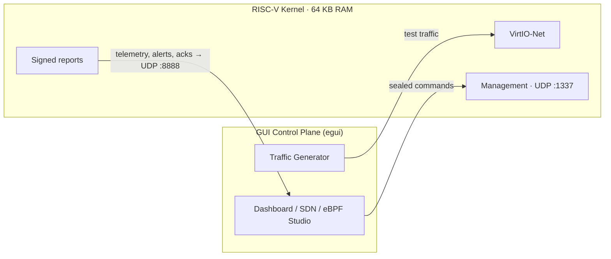
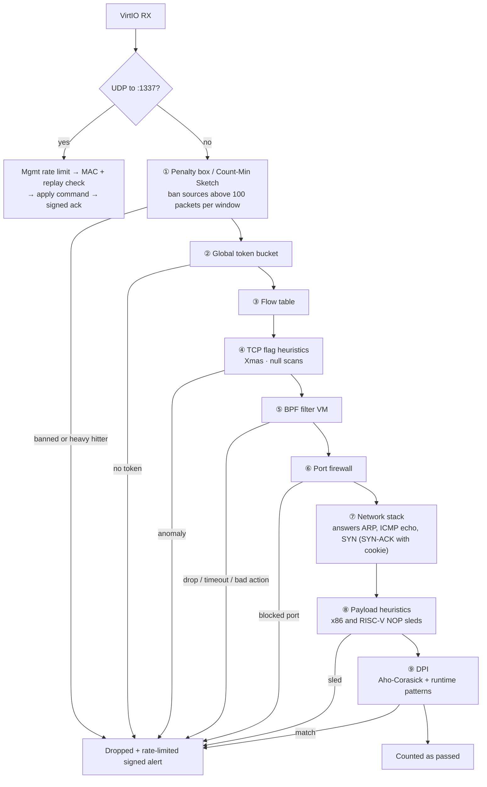
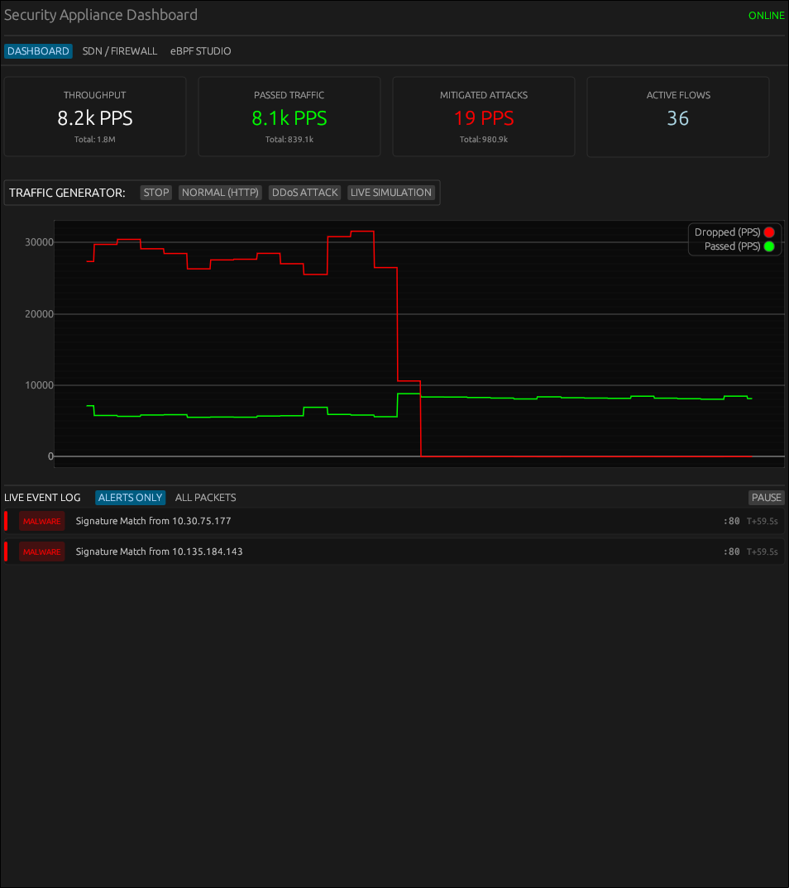

# RISC-V Security Unikernel

A bare-metal **network security appliance** written in Rust, running in M-mode on RISC-V without a host OS. Heavy-hitter DDoS detection, rate limiting, a port firewall, deep packet inspection, heuristics and a programmable packet-filter VM all fit in a **64 KB RAM** budget.

The kernel inspects traffic addressed to it and reports verdicts; it does not forward packets. It is a demonstration of the techniques, not an inline firewall.



---

## The 64 KB Budget

| Structure | Size | Technique |
|---|---|---|
| Count-Min Sketch | 1 KB | 4 × 128 × u16, salted per boot |
| Flow table (74 entries) | ~3 KB | 5-tuple entries, LRU eviction with a minimum age |
| Aho-Corasick automaton | ~1.3 KB | 128-node trie for built-in signatures |
| VirtIO queues and buffers | ~6.3 KB | 2 RX + 2 TX MTU-sized buffers, rings on 64-byte legacy pages |
| BPF program slot | 448 B | 64 instructions × 7 bytes |
| Penalty box | 256 B | 16 bans, round-robin eviction once every slot is active |
| **Hot-path allocations** | **0 B** | No heap; all state is static |

`make check-size` adds a 4 KB stack reserve to `.text + .rodata + .data + .bss` and fails if the total exceeds 64 KB. The current kernel uses about **43.7 KB**.

---

## Packet Processing Pipeline

Every received frame goes through `sec_core::engine::Engine::process`, which is plain Rust with no I/O and runs, is tested and is fuzzed on the host.



Management traffic is handled before any data-plane check, behind its own rate limiter, so no ban, filter program or flood can lock the operator out.

---

## Security Mechanisms

### Count-Min Sketch — heavy-hitter detection
Counts packets per source IP across four salted hash rows. A source whose estimate passes 100 within the current window (`CMS_RESET_INTERVAL_CYCLES`) is banned in the penalty box. The salt is re-drawn from virtio-rng each window.

### Aho-Corasick DPI
Single-pass scan for the built-in signatures `DROP TABLE`, `<script>`, `eval(` and `UNION SELECT`. Up to eight more patterns of up to 32 bytes can be added and removed at runtime. Matching is case-sensitive and per packet.

### BPF filter VM
A small 16-register bytecode VM (not Linux eBPF) with load, move, compare, bitwise, jump and return instructions. Programs are validated on upload (opcodes, registers, jump targets), run with a 1,000-instruction budget per packet, and must return 0 (drop) or 1 (pass). The GUI's eBPF Studio compiles `BLOCK <TCP|UDP> DST <port>` and `DROP ALL`.

### Heuristics
TCP Xmas (FIN|URG|PSH) and null scans; x86 NOP sleds (a decaying score that reaches 8, so interleaved junk bytes do not hide them) and runs of 8 RISC-V NOPs.

---

## Management Protocol

Commands are UDP datagrams to port 1337 carrying `counter (u64) ‖ body ‖ SipHash-2-4 MAC (u64)`. The counter's high 32 bits are the kernel's per-boot epoch and the low 32 bits a strictly increasing sequence, so commands cannot be forged or replayed within or across boots. The key is set at build time (`KERNEL_MGMT_KEY`, or `.mgmt-key.local` created by `make dev-key`).

| Command | Undo |
|---|---|
| `BlockPort` | `UnblockPort` |
| `AddDpiPattern` | `RemoveDpiPattern` |
| `UploadBpfProgram` | `UnloadBpfProgram` |
| `BanIp` | `UnbanIp` |

Every authenticated command is answered with an ack carrying its sequence number and outcome (applied, table full, invalid or refused).

### Reports

Telemetry (every interval), alerts and acks go to UDP port 8888, broadcast until an operator has authenticated and unicast to that operator afterwards. Each is signed with a key derived from the management key, so it cannot be forged or replayed back to the kernel as a command:

`epoch (u32) ‖ sequence (u64) ‖ body ‖ SipHash-2-4 MAC (u64)`

The telemetry body is a type byte followed by ten big-endian u64 counters: passed, DDoS drops, firewall blocks, malware matches, BPF drops, heuristic drops, RAM used, active flows, management packets and the boot epoch.

---

## Dashboard



The companion desktop app (`egui`/`eframe`) shows live counters and the alert log, manages firewall rules, DPI patterns and BPF programs (with the kernel's ack for each), and generates test traffic. It accepts only reports that verify.

**Traffic modes:** Normal (about 2 packets per millisecond), DDoS (300 per millisecond to common ports), Live (normal traffic with periodic attack payloads and DDoS bursts). Run `make setup_net_many` first so the generator sends from 200 real source addresses; otherwise it falls back to 50 sockets on the host and normal traffic trips the heavy-hitter detector.

---

## Technical Specifications

| Property | Value |
|---|---|
| Target ISA | RV64GC (`riscv64gc-unknown-none-elf`) |
| RAM budget | 64 KB |
| Language | Rust `no_std` / `no_main` |
| Network driver | VirtIO-Net (legacy MMIO), polled |
| Concurrency model | Single hart, polling loop; other harts are parked |
| Memory protection | PMP: W^X over the kernel image, MMIO confined to the device window |
| Build profile | `opt-level = "z"`, LTO, `codegen-units = 1`, stripped |

Thresholds and intervals are in `mcycle` cycles, so their wall-clock meaning depends on the CPU's clock rate.

---

## Benchmarks

The pure-logic modules are benchmarked on the host with [Criterion](https://github.com/bheisler/criterion.rs):

```bash
make bench
```

Medians on an Intel Core i7-14700K:

| Benchmark | Median |
|---|---|
| `cms_insert` (single IP) | 8.3 ns |
| `cms_insert_64_ips` (varied) | 7.8 ns |
| `ac_scan_clean_payload` (128 B, no match) | 212 ns |
| `ac_scan_matching_payload` (early match) | 119 ns |
| `vm_execute_6_instructions` | 5.2 ns |
| `flow_update_new_flow` | 109 ns |
| `flow_update_existing_flow` | 3.3 ns |
| `flow_update_full_table_74_flows` | 42 ns |
| `heuristic_check_tcp_flags` | 0.7 ns |
| `heuristic_check_payload_clean` | 66 ns |
| `heuristic_check_payload_nop_sled` | 2.4 ns |
| `full_hot_path_per_packet` (CMS + Aho-Corasick + VM) | 226 ns |

---

## Linux Daemon

`security-daemon` runs the same `sec_core` engine as a Linux program, so the pipeline can be measured on real hardware and real traffic.

```bash
make daemon-bench DAEMON_ARGS="--threads 8 --mix clean"   # in-memory throughput
make daemon-speedtest                                      # live AF_PACKET test over a veth pair, no sudo
sudo ./target/release/security-daemon run --iface eth0     # inspect a real interface (needs CAP_NET_RAW)
```

`run` captures through a memory-mapped `TPACKET_V3` ring and sends replies and signed reports back out of the interface, so the GUI can drive it like the kernel. It takes on the kernel's identity from `sec_core::config` (192.168.100.2, `52:54:00:12:34:56`). `bench` tells the engine traffic arrives at `--offered-pps` (default 10k) while measuring the real CPU cost per frame.

On an Intel Core i7-14700K, one engine handles about **1.1 Mpps** of clean traffic with every frame running the full pipeline (about 890 ns per frame, mostly the Aho-Corasick scan), and attack traffic that is dropped early at about 10 Mpps. Engines are independent, so throughput scales with threads (about 11 Mpps on 16).

The heavy-hitter sketch is sized for the 64 KB kernel: with 128 counters per row it separates sources only while total traffic stays under about 12.8k packets per window. Beyond that every counter passes the threshold and the detector bans everyone, which is what `daemon-speedtest` shows at line rate.

---

## Testing

```bash
cargo test --workspace --exclude security-unikernel   # host unit, property and engine tests
make qemu-test                                         # boots the real kernel in QEMU
make miri                                              # sec-core tests under Miri
make fuzz-engine-sequence ARGS="-- -max_total_time=600"
```

`make qemu-test` exchanges raw Ethernet frames with the kernel over a Unix socket (QEMU's `dgram` netdev), so it needs no tap device or root. Fuzz targets cover the packet stack, the whole engine (single frames and long sequences of frames, sealed commands and clock steps), the management verifier, the VM and the DPI automaton.

---

## Running

**Requirements:** Rust (pinned in `rust-toolchain.toml`; nightly for fuzzing and Miri) · `qemu-system-riscv64` · `iproute2` · `make`

On Nix, `nix develop` provides all of these.

```bash
# Build the kernel, configure the tap interface and launch QEMU
make run

# Launch the GUI (separate terminal)
make gui
```

1. On the **Dashboard** tab, click **NORMAL (HTTP)**, **DDoS ATTACK** or **LIVE SIMULATION**
2. Watch the counters, graph and event log for throughput and drop reasons
3. Use the **SDN / FIREWALL** tab to add or remove firewall rules and DPI signatures
4. Use the **eBPF STUDIO** tab to upload or unload a packet filter

Press `Ctrl+B X` to exit QEMU.
